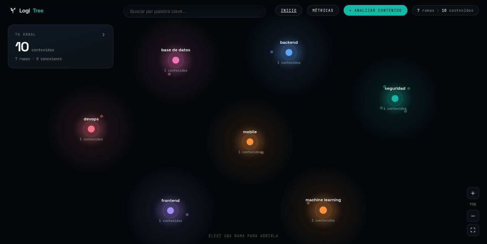
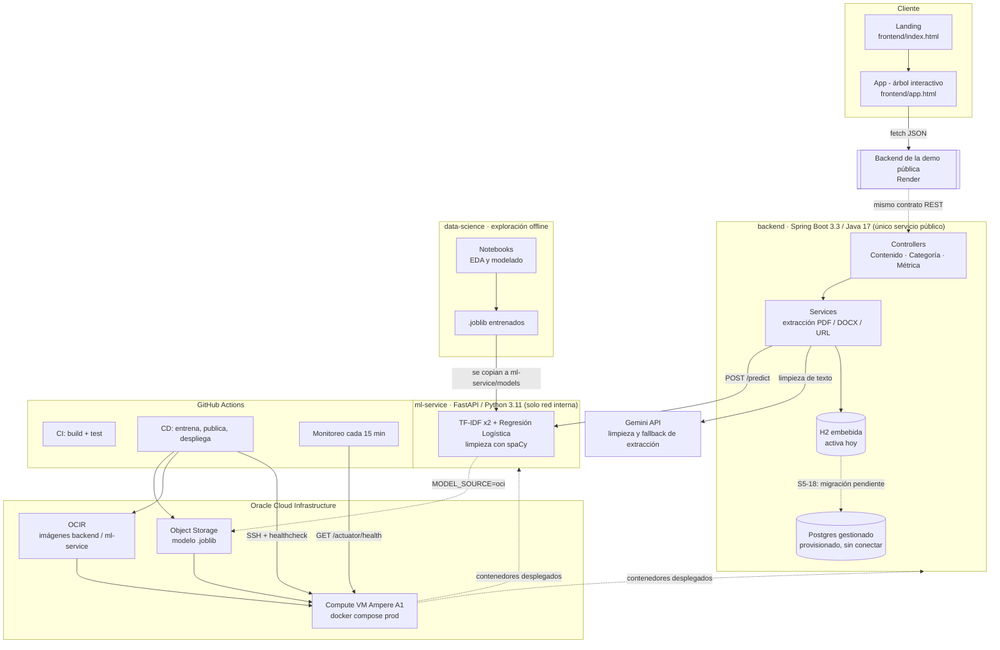

# TechMind · LogiTree

[](https://www.youtube.com/watch?v=Lxw7JM5lzuk)

**Tu conocimiento técnico, organizado en un árbol interactivo.**

LogiTree recibe contenido técnico —texto, PDF, DOCX o una URL— lo clasifica automáticamente con un modelo de Machine Learning, extrae sus palabras clave y lo expone en una API REST y en un cliente visual donde cada contenido procesado se convierte en una rama de tu árbol de conocimiento.

<div align="center">


[](https://github.com/No-Country-simulation/g9-br-team-34-techmind/actions/workflows/ci.yml)
[](https://github.com/No-Country-simulation/g9-br-team-34-techmind/actions/workflows/cd.yml)

</div>

## Tabla de contenidos

- [Qué es LogiTree](#qué-es-logitree)
- [Demo](#demo)
- [El problema](#el-problema)
- [La solución](#la-solución)
- [Características](#características)
- [Arquitectura](#arquitectura)
- [Componentes y stack tecnológico](#componentes-y-stack-tecnológico)
  - [Frontend](#frontend)
  - [Backend](#backend)
  - [IA / Machine Learning](#ia--machine-learning)
  - [Ciencia de Datos](#ciencia-de-datos)
  - [Infraestructura y DevOps](#infraestructura-y-devops)
- [Estructura del proyecto](#estructura-del-proyecto)
- [Instalación y ejecución](#instalación-y-ejecución)
- [Configuración](#configuración)
- [API REST](#api-rest)
- [Manejo de errores](#manejo-de-errores)
- [Pruebas](#pruebas)
- [Despliegue](#despliegue)
- [Contribuyentes](#contribuyentes)

---

## Qué es LogiTree

Un cliente envía contenido técnico —texto directo, un archivo PDF/DOCX o una URL— y LogiTree:

1. Extrae y limpia el texto (si la entrada es un archivo o una URL), usando la **API de Gemini** como paso de limpieza y como respaldo cuando la extracción determinística falla.
2. Lo clasifica en una de **7 categorías** (Backend, Base de Datos, DevOps, Frontend, Machine Learning, Mobile, Seguridad) mediante un modelo entrenado.
3. Extrae sus palabras clave más representativas.
4. Persiste el resultado y lo expone vía API REST, con búsqueda, filtros, paginación, contenidos relacionados y un tablero de métricas.
5. Lo dibuja como un nodo más del árbol interactivo del cliente, agrupado por categoría.

## Demo

▶️ **[Ver el video de demo](https://www.youtube.com/watch?v=Lxw7JM5lzuk)**

### Tu árbol, vista previa

El lienzo infinito donde cada contenido procesado aparece como un nodo del árbol, agrupado por categoría:



## El problema

La documentación técnica de un equipo —notas, PDFs, artículos, hilos de foro— crece rápido y sin estructura. Nadie clasifica ese contenido a mano, así que se vuelve difícil de encontrar y termina duplicado o perdido entre carpetas.

## La solución

LogiTree automatiza la clasificación: cualquier contenido técnico entra por un único punto (texto, archivo o URL) y sale clasificado, con palabras clave y relacionado con lo que ya existe en el repositorio, sin que nadie tenga que etiquetarlo manualmente.

## Características

- ✅ Ingesta de contenido por **texto**, **archivo (PDF/DOCX)** o **URL**
- ✅ Clasificación temática en **7 categorías** con puntaje de confianza
- ✅ Extracción de palabras clave (TF-IDF)
- ✅ Resumen del contenido generado con Gemini
- ✅ Persistencia, consulta individual y listado con filtros, búsqueda y paginación
- ✅ Contenidos relacionados por similitud de categoría y palabras clave
- ✅ Procesamiento por lote: CSV (`/lote`) y múltiples PDFs a la vez (`/lote-pdf`)
- ✅ Tablero de métricas del repositorio (`/api/v1/metricas`)
- ✅ Cliente visual — árbol interactivo — que consume toda la API
- ✅ CI/CD con GitHub Actions: build + test, entrenamiento y despliegue automático, monitoreo de salud cada 15 minutos

## Arquitectura

Dos servicios con una responsabilidad cada uno —Java para la API pública, Python para la inferencia— más los componentes de infraestructura que los rodean:



**Cómo leer este diagrama:**

- El `backend` es el **único servicio expuesto a Internet**; el `ml-service` solo es alcanzable desde la red interna de Docker Compose.
- La **demo pública que consume el frontend** (`frontend/app.html`, `API_BASE`) apunta hoy a una instancia en **Render**, que implementa el mismo contrato REST que los `Controllers` del backend.
- En paralelo, el repositorio tiene una **canalización de CI/CD completa hacia Oracle Cloud Infrastructure** ([`docs/devops/despliegue-oci.md`](docs/devops/despliegue-oci.md)): el workflow de CD entrena el modelo, publica el artefacto en OCI Object Storage, construye y publica las imágenes en OCIR, y las despliega por SSH en una VM `VM.Standard.A1.Flex`, con rollback automático si el healthcheck falla.
- La base de datos activa hoy es **H2 embebida**. Hay un **Postgres gestionado ya provisionado** ([`docs/devops/postgres.md`](docs/devops/postgres.md)) pero todavía sin conectar al backend — es el alcance del ticket S5-18.
- El `ml-service` puede servir el modelo desde el propio contenedor (`MODEL_SOURCE=local`, desarrollo) o descargarlo de OCI Object Storage al arrancar (`MODEL_SOURCE=oci`, producción).

Para el detalle completo de decisiones de infraestructura, ver [`docs/devops/informe-devops.md`](docs/devops/informe-devops.md).

## Componentes y stack tecnológico

| Capa | Tecnología |
|---|---|
| **Frontend** | HTML/CSS/JS, sin framework — landing + árbol interactivo (Vercel) |
| **Backend / API REST** | Java 17, Spring Boot 3.3, Spring Data JPA, Bean Validation, springdoc-openapi (Swagger UI), WebFlux (cliente HTTP reactivo) |
| **Extracción de archivos** | Apache PDFBox (PDF), Apache POI (DOCX), jsoup (HTML/URL) |
| **Limpieza / fallback de extracción** | Gemini API |
| **Persistencia** | H2 (archivo, activa) · Postgres gestionado (provisionado, integración pendiente) |
| **Servicio de inferencia** | Python 3.11, FastAPI, scikit-learn (TF-IDF ×2 + Regresión Logística), spaCy, Pydantic |
| **Ciencia de Datos** | pandas, notebooks Jupyter (EDA, modelado, métricas) |
| **Infraestructura** | Docker, Docker Compose v2.24+, Terraform, Oracle Cloud Infrastructure (Object Storage, OCIR, Compute) |
| **CI/CD** | GitHub Actions — CI, CD hacia OCI, monitoreo de salud cada 15 min |
| **Proxy / HTTPS** | Caddy (opcional, perfil `https`, certificados automáticos vía Let's Encrypt) |

### Frontend

Cliente estático en HTML/CSS/JS puro (`frontend/`), sin build step:

- **`index.html`** — landing de presentación de LogiTree.
- **`app.html`** — la aplicación: dibuja cada contenido procesado como un nodo de un árbol interactivo agrupado por categoría, con vista de detalle, alta de contenido (texto/PDF) y un dashboard de métricas.
- Consume la API REST directamente desde el navegador (`API_BASE` apunta a la instancia pública del backend); no tiene build ni variables de entorno propias.
- Desplegado en Vercel (`vercel.json`); el origen se autoriza en el backend vía `CORS_ALLOWED_ORIGINS`.

### Backend

API REST en Spring Boot, con separación estricta por capas (`controller` → `service` → `repository`), donde los controladores no contienen lógica de negocio.

- **Controllers:** `ContenidoController`, `CategoriaController`, `MetricaController`.
- **Services:** `ContenidoService` (orquesta clasificación y persistencia), `ExtraccionArchivoService` + parsers de PDF/DOCX/HTML.
- **Persistencia:** entidad `ContenidoAnalizado` sobre H2 (prod) / Postgres (pendiente).
- **Integraciones salientes:** `ml-service` (`POST /predict`) y Gemini API (limpieza y extracción de respaldo).
- Documentación completa de la arquitectura interna, modelo de dominio, configuración y decisiones de diseño: **[`backend/README.md`](backend/README.md)**.

### IA / Machine Learning

Servicio interno en FastAPI (`ml-service/`) que sirve el modelo de clasificación por HTTP; solo lo consume el backend.

- Combina **dos `TfidfVectorizer`** (título y texto, con el título pesado el doble) y una **Regresión Logística** ya entrenada.
- Limpieza de texto con **spaCy** (`es_core_news_sm`) antes de vectorizar.
- No entrena en tiempo de ejecución: el artefacto (`modelo_clasificador.joblib`, `tfidf_titulo.joblib`, `tfidf_texto.joblib`) se genera aparte y se sirve estático.
- Documentación completa (endpoints, artefacto del modelo, origen local vs. OCI, decisiones de diseño): **[`ml-service/README.md`](ml-service/README.md)**.

### Ciencia de Datos

`data-science/` es el espacio exploratorio, separado del pipeline productivo:

- `notebooks/` — EDA, entrenamiento y métricas en Jupyter.
- `data/` — datasets versionados (`v2`, `v3`, `v4`).
- `models/` — artefactos `.joblib` entrenados por el equipo, que se copian a `ml-service/models/`.
- `API/` — prototipo original del servicio de inferencia (previo a `ml-service/`).

El contrato REST/JSON entre Backend y Ciencia de Datos —campos, las 7 categorías, convenciones de nombres— está acordado y documentado en **[`docs/contrato-backend-ds.md`](docs/contrato-backend-ds.md)**.

### Infraestructura y DevOps

- **Docker / Docker Compose** — `docker-compose.yml` (desarrollo) y `docker-compose.prod.yml` (sobrescritura para producción en OCI).
- **Terraform** (`infra/terraform/`) — crea de punta a punta la red, la VM `VM.Standard.A1.Flex`, el bucket de Object Storage y los permisos de OCI necesarios. Guía completa: **[`infra/terraform/README.md`](infra/terraform/README.md)**.
- **GitHub Actions** — `ci.yml` (build + test en cada push/PR), `cd.yml` (entrena, publica y despliega en OCI con rollback automático) y `monitoreo.yml` (chequeo de `/actuator/health` cada 15 minutos).
- **Caddy** (`caddy/Caddyfile`) — proxy inverso opcional con HTTPS automático, detrás de un perfil de Compose.
- **Scripts** (`scripts/`) — `provision-vm.sh`, `configurar-github.sh`, `smoke-test.sh`, `backup-datos.sh` y la batería de aceptación en `scripts/aceptacion/`.
- Guía operativa completa de despliegue en OCI (runbook, secrets, HTTPS, troubleshooting): **[`docs/devops/despliegue-oci.md`](docs/devops/despliegue-oci.md)**. Decisiones de infraestructura y su justificación: **[`docs/devops/informe-devops.md`](docs/devops/informe-devops.md)**.

## Estructura del proyecto

```
.
├── backend/                    API REST en Spring Boot (Java 17)
├── ml-service/                 Servicio de inferencia en FastAPI (Python 3.11)
├── data-science/               Exploración y modelado (fuera del pipeline productivo)
├── frontend/                   Landing + árbol interactivo (HTML/CSS/JS)
├── infra/terraform/            Infraestructura como código para OCI
├── docs/                       Documentación técnica y de DevOps
│   └── devops/
├── scripts/                    Provisión, backups, smoke tests, aceptación
├── caddy/                      Proxy inverso opcional con HTTPS automático
├── .github/workflows/          CI, CD y monitoreo
├── docker-compose.yml          Orquestación para desarrollo local
├── docker-compose.prod.yml     Sobrescritura para producción en OCI
├── Makefile                    Atajos de desarrollo y operación
└── .env.example                Plantilla de variables de entorno
```

## Instalación y ejecución

**Requisitos:** Docker con Compose v2.24 o superior. No hace falta tener Java, Python ni Maven instalados — todo corre en contenedores.

```bash
git clone https://github.com/No-Country-simulation/g9-br-team-34-techmind.git
cd g9-br-team-34-techmind

make env      # crea el .env a partir de .env.example
make up       # construye y levanta backend + ml-service
```

Al terminar quedan disponibles:

| Servicio | URL |
|---|---|
| API REST | http://localhost:8080 |
| Swagger UI | http://localhost:8080/swagger-ui/index.html |
| Salud de la API | http://localhost:8080/actuator/health |
| Documentación del modelo (OpenAPI) | http://localhost:8000/docs |
| Salud del modelo | http://localhost:8000/health |

Verificación de punta a punta:

```bash
make smoke
```

Comandos frecuentes (`make` sin argumentos lista todos):

| Comando | Qué hace |
|---|---|
| `make up` / `make down` | Levanta / detiene el sistema |
| `make logs` / `make logs-backend` / `make logs-ml` | Sigue los logs |
| `make test` | Pruebas de backend y ml-service |
| `make train` | Reentrena el modelo en local |
| `make lint` | Analiza el código Python (ruff) |
| `make shell-backend` / `make shell-ml` | Abre una shell dentro de un contenedor |
| `make rebuild` | Reconstruye ignorando la caché de Docker |
| `make clean` / `make clean-all` | Limpia artefactos locales (el segundo borra también la base de datos) |

**Sin Docker**, cada servicio documenta su arranque nativo en su propio README: [`backend/README.md`](backend/README.md) (`./mvnw spring-boot:run`, requiere JDK 17) y [`ml-service/README.md`](ml-service/README.md) (`uvicorn app.main:app --reload`, requiere Python 3.11+).

## Configuración

Variables principales (plantilla completa en [`.env.example`](.env.example) y [`backend/.env.example`](backend/.env.example)):

| Variable | Descripción | Default |
|---|---|---|
| `SERVER_PORT` / `BACKEND_PORT` | Puerto del backend | `8080` |
| `ML_SERVICE_PORT` | Puerto del ml-service (solo expuesto en dev) | `8000` |
| `CORS_ALLOWED_ORIGINS` | Orígenes permitidos por CORS | `http://localhost:3000` |
| `INFERENCE_SERVICE_URL` | URL base del `ml-service` | `http://localhost:8000` |
| `DATABASE_URL` | Connection string de Postgres (aún sin consumir por Spring — ver [`docs/devops/postgres.md`](docs/devops/postgres.md)) | *(vacío)* |
| `GEMINI_API_KEY` | Clave de la API de Gemini | *(vacío)* |
| `OCI_AUTH_METHOD` / `OCI_BUCKET_NAME` / `OCI_NAMESPACE` | Configuración de OCI Object Storage | ver `.env.example` |
| `TECHMIND_API_KEY` | Clave prevista para autenticación (filtro aún no implementado) | *(vacío)* |
| `MAX_KEYWORDS` | Palabras clave devueltas por contenido | `5` |

## API REST

Todos los endpoints viven bajo `/api/v1`. Referencia interactiva completa: **http://localhost:8080/swagger-ui/index.html**. Contrato detallado (campos, categorías, convenciones): **[`docs/contrato-backend-ds.md`](docs/contrato-backend-ds.md)**.

| Método | Ruta | Descripción |
|---|---|---|
| `POST` | `/api/v1/contenidos` | Clasifica y persiste un contenido enviado como texto |
| `POST` | `/api/v1/contenidos/archivo` | Ídem, extrayendo texto de un PDF o DOCX subido |
| `POST` | `/api/v1/contenidos/url` | Ídem, extrayendo texto de una URL |
| `POST` | `/api/v1/contenidos/lote` | Procesa un CSV (`titulo,texto`) en lote |
| `POST` | `/api/v1/contenidos/lote-pdf` | Procesa varios PDFs en una sola operación, cada uno de forma independiente |
| `GET` | `/api/v1/contenidos/{id}` | Obtiene un contenido ya procesado |
| `GET` | `/api/v1/contenidos` | Lista contenidos, con filtro por categoría, búsqueda por palabra clave y paginación |
| `GET` | `/api/v1/contenidos/{id}/relacionados` | Contenidos relacionados (misma categoría + palabras clave en común); `limite` opcional (1–20, default 5) |
| `DELETE` | `/api/v1/contenidos/{id}` | Elimina un contenido procesado |
| `GET` | `/api/v1/categorias` | Categorías presentes en el repositorio, con conteo de contenidos |
| `GET` | `/api/v1/metricas` | Tablero de métricas del repositorio (totales, confianza media, distribución, top de palabras clave) |
| `GET` | `/actuator/health` | Salud de la API |

**Ejemplo — clasificar contenido por texto:**

```json
// POST /api/v1/contenidos
{
  "titulo": "Introducción a Spring Boot",
  "texto": "En este contenido se presentan los conceptos básicos para la creación de APIs REST utilizando Java y Spring Boot."
}
```

```json
// 201 Created
{
  "id": "0f2a1c3e-...",
  "titulo": "Introducción a Spring Boot",
  "texto": "En este contenido se presentan los conceptos básicos...",
  "resumen": "Guía breve sobre cómo construir APIs REST con Spring Boot.",
  "categoria": "Backend",
  "probabilidad": 0.89,
  "informacion_adicional": ["Java", "Spring Boot", "API REST"],
  "fechaProcesamiento": "2026-08-14T10:32:00Z"
}
```

## Manejo de errores

Centralizado en `GlobalExceptionHandler`, con un formato uniforme (`ErrorResponseDTO`) para toda respuesta de error:

| Situación | HTTP |
|---|---|
| Validación de campos / parámetro inválido | `400` |
| Contenido o recurso no encontrado | `404` |
| Archivo o CSV no procesable | `422` |
| Archivo supera el tamaño máximo | `413` |
| Servicio de inferencia no disponible | `503` |
| Error no controlado | `500` |

El catálogo de mensajes de error mostrados al usuario (backend + frontend) está documentado en **[`docs/S5-01-catalogo-errores.md`](docs/S5-01-catalogo-errores.md)**.

## Pruebas

```bash
make test        # backend (Maven) + ml-service (pytest)
make smoke        # verifica el sistema levantado, de punta a punta
```

El proyecto pasa **37/37 casos** de una batería de aceptación end-to-end sobre todos los endpoints públicos. Detalle de casos y evidencia: **[`docs/pruebas-aceptacion-e2e.md`](docs/pruebas-aceptacion-e2e.md)**.

## Despliegue

El despliegue automatizado hacia **Oracle Cloud Infrastructure** se dispara en cada push a `main` ([`.github/workflows/cd.yml`](.github/workflows/cd.yml)):

1. Entrena el modelo y publica el artefacto en OCI Object Storage.
2. Construye y publica las imágenes de `backend` y `ml-service` en OCIR.
3. Actualiza los contenedores en la VM de producción (`VM.Standard.A1.Flex`) por SSH.
4. Si el healthcheck falla, **revierte automáticamente** a la versión anterior.

Un workflow separado monitorea `/actuator/health` cada 15 minutos ([`.github/workflows/monitoreo.yml`](.github/workflows/monitoreo.yml)).

Guía completa —aprovisionamiento con Terraform, secrets de GitHub Actions, primer despliegue, HTTPS opcional y runbook de incidentes—: **[`docs/devops/despliegue-oci.md`](docs/devops/despliegue-oci.md)**.

## Contribuyentes

| Colaborador |
|---|
| [Jose Ilizarbe](https://github.com/Ilizarbejose) |
| [Ruth Saldivia](https://github.com/ruuuuusu) |
| [Luigui Huánuco](https://github.com/Vanzhel01) |
| [Juan Esteban Herrera](https://github.com/JuanEstebanHerreraH) |
| [Sofía Alférez Ycomena](https://github.com/keiko-404) |
| [Lucas Viveros](https://github.com/Lucatsi) |
| [Jorge Martinez](https://github.com/devjorgem) |
| [Cynthia Michinski](https://github.com/accountCynthia14) |
